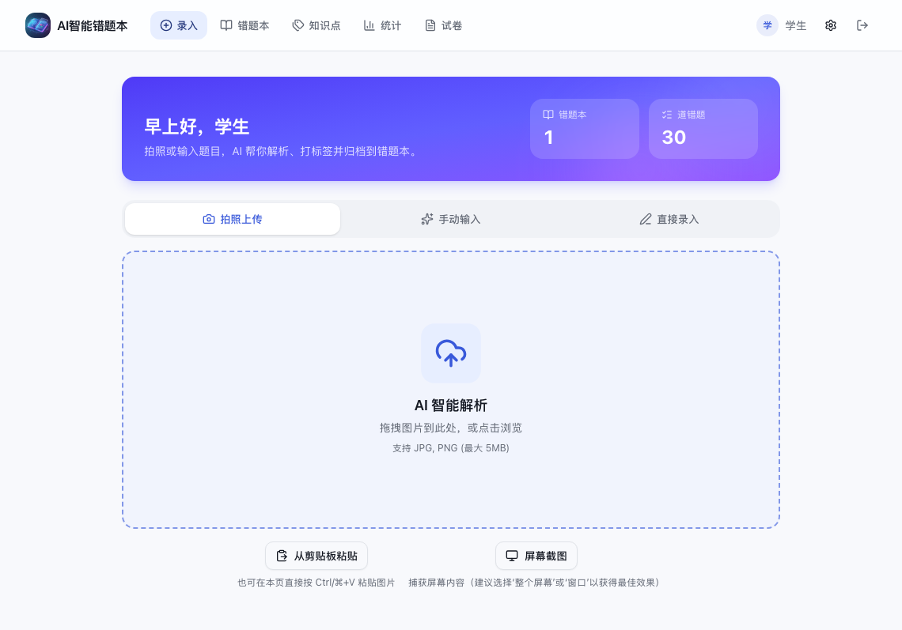
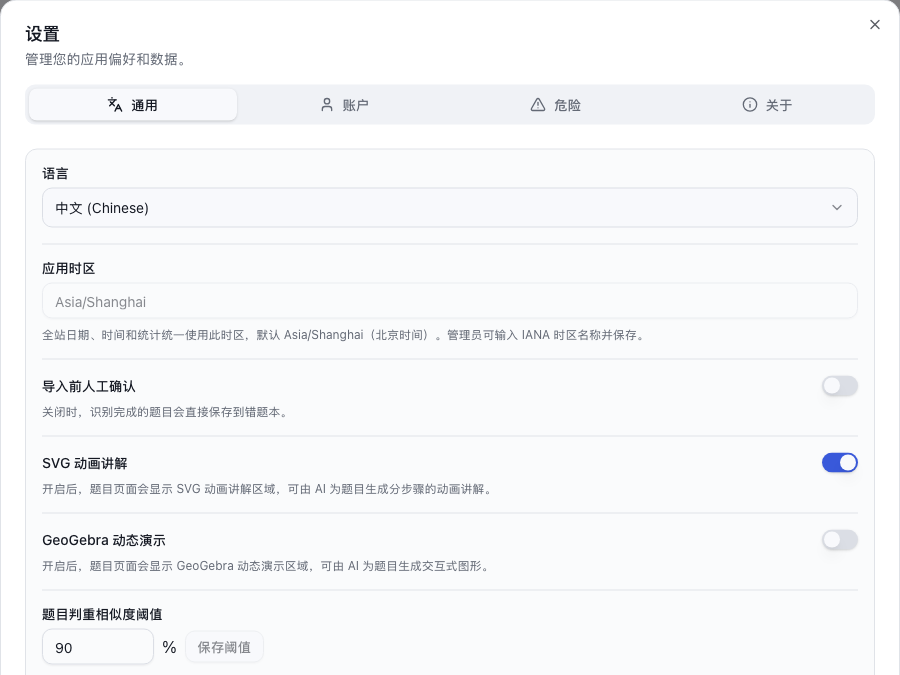
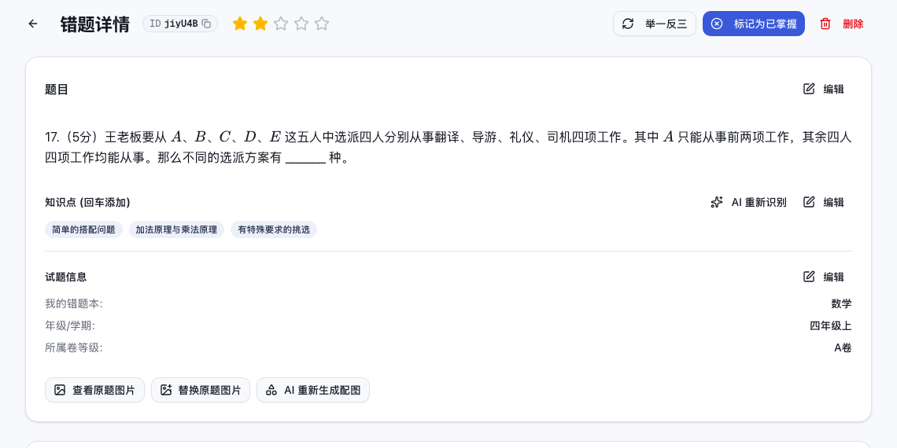
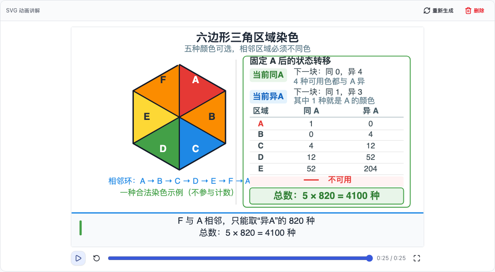
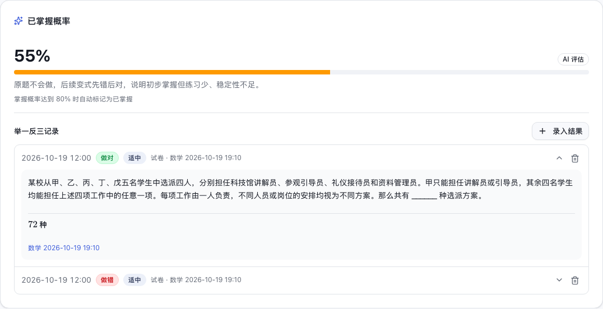
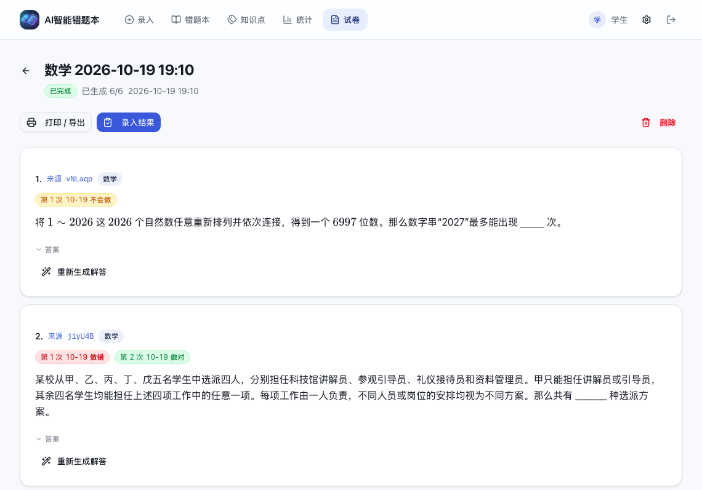
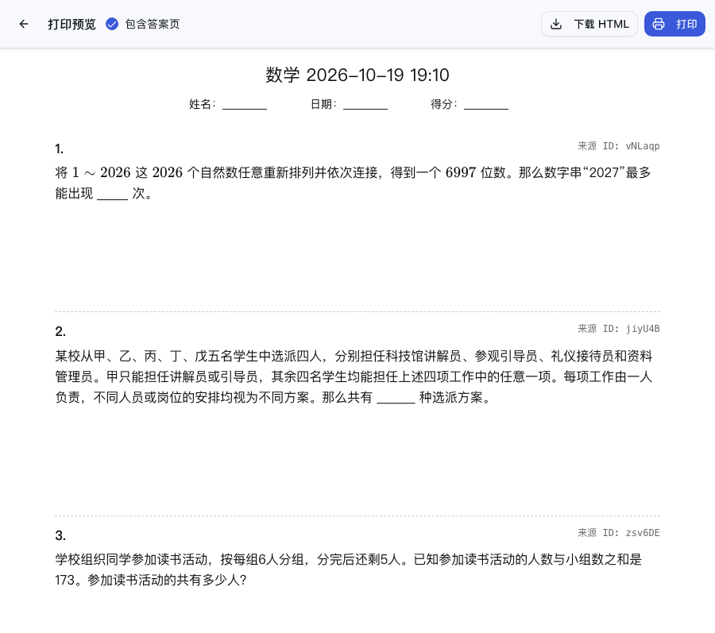
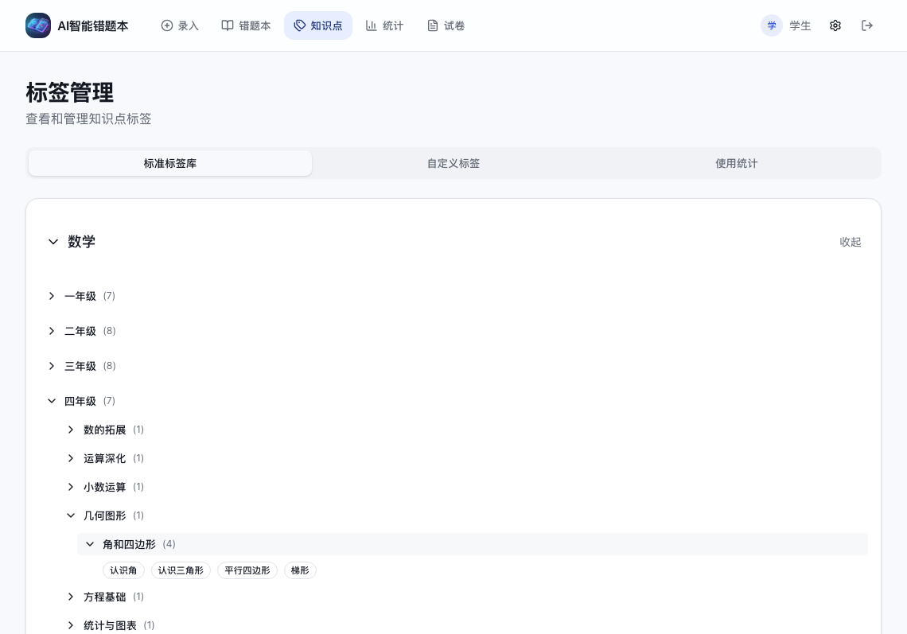
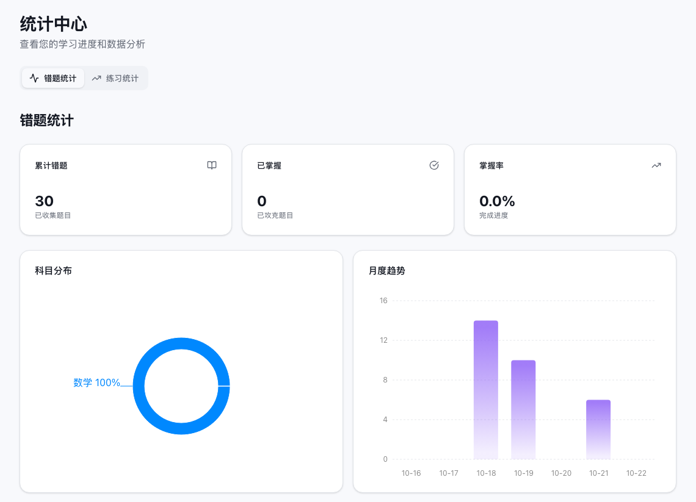
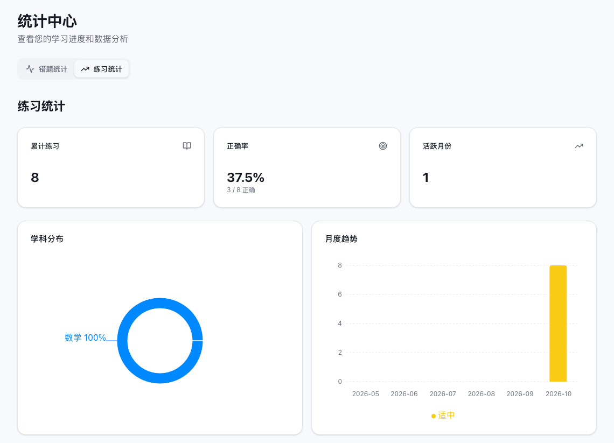

# 错因 Agent · wrong-notebook 复刻增强版

基于 [margrop/wrong-notebook v2026.10.26](https://github.com/margrop/wrong-notebook/releases/tag/v2026.10.26)，保留上游错题本功能，并加入原 V1 的知识漏洞诊断流程。保留上游 MIT 许可，来源与源码摘要见 [UPSTREAM.json](UPSTREAM.json)。

## 本机启动

双击根目录的 **启动错因Agent.command**（Mac），浏览器打开 <http://localhost:3333>。使用期间保留启动窗口；关闭窗口或按 Ctrl+C 停止。Windows 可使用 `启动错因Agent.cmd`。

首次账号 `admin@localhost`，密码 `123456`，按安装向导修改密码并配置自己的 AI 服务。未配置 AI 时仍可手工录入题目和诊断卡。

新环境先安装 Node.js 22.15+，执行 `npm ci --registry=https://registry.npmjs.org` 与 `npx prisma generate`，再运行启动文件。

固定外网网址使用独立的正式版：在 `.env` 填写 `CUOYIN_PUBLIC_URL`，将已有穿透服务指向 `http://127.0.0.1:3334`，再运行 **启动错因Agent正式版.command**。账号、错题和 AI 设置沿用本地数据；首次构建及更新方法见[固定网址访问](doc/REMOTE_ACCESS.md)。穿透平台的域名和授权需要先完成配置。

cpolar 用户可预留固定二级域名，配置 `subdomain` 和相同地区，再双击 **启动错因Agent外网.command**。隧道目标为 `127.0.0.1:3334` 时启动本机正式版；目标为 NAS 等其他地址时，先检查该服务健康，再只启动隧道。使用本机正式版时，`.env` 的 `CUOYIN_PUBLIC_URL` 须与 HTTPS 地址一致。关闭窗口时隧道停止。本次固定网址连接群晖已有数据，Mac 本机数据库与群晖数据库各自独立。

## 这份版本新增了什么

- 题目详情中的“知识漏洞诊断”：首个卡点、未使用条件、原文证据、表层错因、深层漏洞、触发规则与学生追问。
- AI 或手工记录均先成为候选；学生可以确认、标记不确定或拒绝。AI 证据无法在题干或作答中找到时拒绝保存；缺少作答时要求补充信息。
- 确认诊断并人工复核小练与答案后，记录独立完成、需要提示或仍有困难。
- “知识单元”页跨题汇总练习。同一用户、学段、学科下名称、触发规则及适用边界相同的单元复用；至少两个原题情境连续独立通过才显示“已跨题验证”。旧小练记录缺少先作答证据，保留历史但不计为独立通过。
- 修改题干、作答或参考解答后，旧诊断会标记过期并停止参与掌握统计；原有记录保留。
- 上游导出/导入同时保留诊断、确认状态、知识单元和小练历史。

本机数据使用 `data/cuoyin-fork.db`；此前下载安装的官方桌面版使用自己的数据目录。两者可通过设置里的备份导入导出迁移，官方版本不能完整恢复本分支新增的诊断数据。

原始 V1 完整备份位于 [legacy-v1/2026-10-29-v1.1.2](legacy-v1/2026-10-29-v1.1.2)，逐文件 SHA-256 清单为 `BACKUP-MANIFEST.json`。原诊断文档另保留于 [doc/cuoyin-v1](doc/cuoyin-v1)。这次没有自动导入旧照片；可在网页选择照片上传。

网页上传、拖拽和替换原题图片支持 JPG、PNG、WebP、GIF、HEIC/HEIF、BMP 和 AVIF。剪贴板提供图片文件时也可直接粘贴，包括只有扩展名可用于识别格式的 iPhone 原图。HEIC/HEIF 在浏览器本地转成 JPEG 后再裁剪，多图文件只导入主图。

默认图片识别会将题目配图重绘成紧凑的 SVG 示意图，保留解题所需的结构和标注。需要更详细的图时，可在题目详情页点击「AI 重新生成配图」。

拍照导入时会一并保存整张试卷的原图，并关联到本次导入的每道错题；错题详情页点「整卷原图」可随时回看当时拍的整卷。校对页和错题详情页的原图支持点击放大全屏查看，详情页默认显示原图，宽屏时与题干左右并排并随页面滚动保持可见，方便对照检查识别结果。AI 重绘的配图如有失真，详情页会提示以上方原图照片为准。

识别时没认出学生的错误作答，可在详情页「我的答案」卡片点「拍照识别错答」：拍作答区域的照片，AI 摘录手写作答原文并保存照片，作答状态自动改为「做错了」。SVG 动画讲解支持分步点击：动画下方列出关键步骤，点某一步直接从该处开始播放。

“校对与保存”页按题号和「题目 / 答案 / 解析 / 错因」两层分类，默认显示排版预览，长内容可展开或收起，原图与知识点按需查看。点击“源代码”或双击预览可修改当前题的文字和公式；无法匹配题号的内容可从「全文」查看和编辑。分类不删除原文，保存仍包含整份识别结果；需要逐题独立入库时，请使用上传时的多题框选。

详细使用方法和验收说明：[复刻版使用指南](doc/CUOYIN_FORK.md)。

本复刻版已将所有数学错题本的自动知识点统一到**浙教版初二上**，含必要的前置基础；不再借用原人教版标签树的同名学期。几何最短路径使用明确的应用标签，不能确定时留空。校对页展开「知识点」后可按题号修改，每题最多 5 个，随题保存并纳入备份；旧题需点击「重新识别知识点」后更新。清单来源与限制见[数学教材范围](doc/MATH_CURRICULUM.md)。

---

以下为上游项目原始说明。

<p align="center">
  
</p>

# Smart Wrong Notebook (智能错题本)

**简体中文** | [English](README.en.md)

[](LICENSE) [](https://github.com/margrop/wrong-notebook/releases) [](https://github.com/margrop/wrong-notebook/actions/workflows/ci.yml) [](https://github.com/margrop/wrong-notebook/actions/workflows/codeql.yml) [](https://www.npmjs.com/package/wrong-notebook)

一个基于 AI 的智能错题管理系统：拍照或输入题目后，由 AI 识别、解答、打知识点标签并评定难度，支持错题本管理、举一反三练习、组卷打印和掌握程度跟踪。

🌐 **项目介绍页**：<https://blog.margrop.net/wrong-notebook-github-pages/>

🚀 **在线演示**：<https://wrong-notebook-demo.vercel.app>（账号 `demo@localhost`，密码 `demo123456`）

> 演示站点为共享账号，数据对所有访客可见，请勿录入个人信息。

📦 **多平台安装**：Docker 镜像（amd64 / arm64）· npm（`npm i -g wrong-notebook`）· Windows · macOS · Linux · 飞牛OS · 安卓手机 / 平板（单机版内置服务端，或连接服务器的客户端），安装包见 [Releases](https://github.com/margrop/wrong-notebook/releases)，安装方式见[快速开始](#-快速开始)。

🆓 **免费的 MiniMax 账号就能用**：选择「MiniMax Code OAuth」渠道，用 MiniMax Code 账号网页登录即可调用 `MiniMax-M3.1-Flash`，不需要购买 API Key。应用每天自动签到领取积分，识题、讲解等 AI 功能消耗的是账号的免费积分额度，详见 [MiniMax Code OAuth](#minimax-code-oauth)。

> 本仓库 fork 自 [wttwins/wrong-notebook](https://github.com/wttwins/wrong-notebook)，在其基础上增加了较多功能（见下文）。

## 🖼️ 功能预览

以下截图采集自实际运行的应用（2026-10-20），展示已有题目、讲解和试卷。用户名已遮挡，可点击图片查看大图。

**错题管理**：在同一页面查看题目摘要、难度星级和知识点，按年级、学期、掌握情况及 A/B 卷筛选，也可通过题目 ID 定位、比较相似度或批量打印。

列表按需加载卡片数据，原图、答案和解析在详情或打印预览时读取，减少翻页时的数据传输。


<details>
<summary><strong>录入与偏好：拍照上传、文字录入、人工确认和可配置判重</strong></summary>

首页提供拍照上传、手动输入和直接录入入口，支持拖拽图片与剪贴板粘贴。



单题始终先校对后保存。通用设置可调整 SVG 动画讲解和题目判重相似度阈值。



</details>

<details>
<summary><strong>题目详情：公式排版、难度星级、知识点和试题信息</strong></summary>

一道错题集中展示题干、知识点、年级学期与试卷等级，可核对原题图片，并从详情页进入举一反三。



</details>

<details>
<summary><strong>SVG 动画讲解：把解题思路变成分步骤的动态演示</strong></summary>

下图为已有六边形染色题的动画讲解，展示区域关系与递推计数过程；播放器支持暂停、拖动进度、重播和全屏。



</details>

<details>
<summary><strong>复习反馈：回看变式题、作答历史和 AI 掌握概率</strong></summary>

原题下汇总举一反三和试卷作答结果，展开记录可回看变式题与答案。AI 根据实际作答历史评估掌握概率，辅助安排后续复习。「已掌握」的确认规则：概率达标只是必要条件，还需要在至少两道不同变式题中独立答对（同一题隔天或换来源作答仍算同一情境；没有题目快照的旧记录不能证明跨题；作答前看提示或解答不算独立通过），并在一次已完成的复习之后再次独立答对；条件不足时保持「复习中」，界面会提示还差哪一步（如「等待后续复习验证」）。后续复习做错会自动回到「复习中」，练习历史保留。知识漏洞诊断按「错在哪 → 为什么 → 接下来练什么」三步呈现，深层分析可折叠展开。

练习题关联已确认且未过期的知识漏洞时，页面会按「未用条件 → 触发规则 → 首个卡住步骤」依次展示可用提示。练习记录保存最高提示级别；使用提示后答对、直接看答案后自报做对，都不计为独立通过。没有可用诊断时保留原有练习流程。

知识漏洞报告默认只展示最近一条的「错在哪」，可依次查看「为什么」和「接下来练什么」，完整诊断与证据可按需展开。知识单元掌握状态分为待验证、初步通过、跨题验证中、暂时掌握和稳定掌握；边界对比题与后续复习是进入后两档的必要证据，失败会回退。

这类举一反三题生成时还会把漏洞类型、触发规则、适用边界、未用条件和首个卡点传给 AI，要求题目检验规则的适用条件。生成结果会先检查题干、答案和解析是否存在；目前这一步尚不等于数学正确性证明。



</details>

<details>
<summary><strong>组卷与打印：针对错题生成试卷，做完后按题回填结果</strong></summary>

生成的试卷保留来源题目 ID，并展示各次作答结果，方便回到原题跟踪复习效果。



打印预览可选择包含答案页，支持下载 HTML、打印或通过浏览器保存为 PDF。



</details>

<details>
<summary><strong>知识点库：按学科、年级、章节逐级浏览</strong></summary>

标准标签库按教学层级组织知识点。知识点已并入「统计」栏目：「知识点管理」页签可浏览标准标签库、增删自定义标签，「知识点统计」页签显示使用频率。



</details>

<details>
<summary><strong>学习统计：查看错题分布、掌握率、练习正确率和趋势</strong></summary>

错题统计展示累计错题、已掌握数量、掌握率、科目分布和月度趋势。



练习统计单独展示累计练习、正确率和活跃月份，并按学科、难度观察练习分布与趋势。



</details>

## ✨ 主要功能

### 录入与识别

- **📷 多种录入方式**：上传图片、从剪贴板粘贴（Ctrl/⌘+V）、屏幕截图，或直接输入题目文字（支持 Markdown 和 LaTeX）；图片可裁剪（支持滚轮、双指捏合或按钮缩放图片，方便精确框选），也可在一张图上框选多道题批量导入。题目文字与几何图/函数图在卷面上分离时，用「一题拼图」为同一道题框多个区域，自动按版面顺序拼接成完整题图。
- **🤖 AI 识别与解答**：识别题目文字、答案、解析、学生的错误解答和错因，判断学科，并从知识点库中选择标签。单题识别和文字解题始终先进入校对页，修改题目、选择错题本后点击保存。解析聚焦关键步骤，错因附上可立即执行的改进动作；没有作答证据时不猜测错因。
- **🔁 重复题判定**：导入时比较题干相似度，超过阈值（默认 90%，可在设置中调整）的题目不会重复导入，而是在原题下记一次做错。
- **🆔 题目 ID**：每道题有 6 位 ID，可复制，也可在错题本中输入 ID 直接打开该题；打印的错题和试卷都标有「来源 ID」，方便做完后定位原题录入结果。

### 题目内容

- **∑ LaTeX 公式**：题目、答案和解析中的公式用 KaTeX 显示，支持 `$…$`、`$$…$$`、`\(…\)`、`\[…\]`；编辑时可在「源代码 / 预览」之间切换。检测到公式语法错误时，详情页出现「修复 LaTeX」按钮，由 AI 只修复公式写法。
- **📝 重新生成解答**：详情页「重新生成完整解答」由 AI 重新生成答案和解析（覆盖前二次确认），知识点和错因保持不变。
- **🖼️ 题目配图**：识别时由 AI 用 SVG 重绘题目配图，详情页、打印和试卷都使用 SVG 配图；拍照原图可在「查看原题图片」中核对，也可替换或补充上传。
- **⭐ 难度星级**：导入时由 AI 参考《高思学校竞赛数学导引》的星级标准评定 1~5 星（一二星为课本及校内拔高，三四星为常规奥数，五星为竞赛压轴），可手动修改；4 星及以上默认归入 B 卷。
- **🏷️ 知识点标签**：错题本创建时选择学段（小学/初中/高中）和学科（创建后不可修改），本错题本内的题目由 AI 从该学段、该学科的全部知识点中选择标签；支持自定义标签，单题或整本错题本可让 AI 重新识别知识点和难度。

### 讲解与演示

- **SVG 动画讲解**：首次打开题目时自动生成当前界面语言的动画，首次生成需要等待；之后直接播放已保存的版本，不重复调用 AI。支持暂停、进度拖动、重播和全屏。生成失败可手动重试，删除后本次查看不自动重建。默认开启，可在通用设置中关闭。
- 已生成的 SVG 动画讲解可删除（需二次确认）。

### 复习与练习

- **🔄 举一反三**：基于错题生成同知识点的变式题（填空或解答题），可选难度；提交答案后自动判题（写法一致直接判对，否则由 AI 对照标准答案判定并给出依据），保存前可修改结果；每道错题暂存最近一次生成的变式题与解答，再次进入时直接显示，需要新题再点「重新生成」。
- **📈 掌握概率**：根据举一反三和试卷的作答历史，由 AI 评估每道题的已掌握概率。错题分为三种状态：没有举一反三记录的为「待复习」，有记录且掌握概率低于 50% 的为「复习中」，达到 50% 的为「已掌握」。
- **📅 今日复习**：按 1、2、4、7、15、30 天的艾宾浩斯间隔安排每道错题的复习，做对进入下一轮间隔，做错从头开始。导航栏的「复习」页列出今天到期的错题（最早到期的在前），首页显示今日待复习数量。
- **🧾 错题试卷**：按错题本、知识点和掌握情况随机抽题，用举一反三生成一套可打印的试卷；做完后可按题录入结果，结果计入原题的作答历史。
- **🖨️ 错题打印**：筛选后打印错题，可选打印题目文字或原图、答案、解析、知识点，调节图片比例，可直接打印或保存为 PDF。

### 管理与统计

- **🔍 多维度筛选**：按掌握状态、时间范围、知识点、年级学期、试卷等级等条件筛选，支持批量操作和两题相似度比较。
- **📊 数据统计**：错题与练习的掌握率、月度趋势和学科分布。
- **⏳ 后台任务**：页面右下角的按钮可查看识别、AI 生成、批量标注、组卷等耗时事务的进度；离开页面后事务仍在服务器上继续。
- **💾 数据导入导出**：在「设置」中导出或导入数据备份，包含错题本、错题、练习与作答记录、试卷和个人偏好；账户凭据和 AI 配置不在备份中。
- **🕒 应用时区**：默认北京时间，管理员可修改，日期显示与统计都按应用时区计算，详见 [时区说明](doc/TIME_ZONE.md)。
- **🧭 安装向导**：管理员首次登录时进入向导：修改默认密码（必须）→ 配置 AI 渠道（推荐免费的 MiniMax Code）→ 创建第一个错题本，后两步可跳过；可在「设置 → 用户管理」中重新运行。已在使用的实例升级后不会自动弹出。
- **🔐 多用户与管理后台**：支持注册、登录，数据按用户隔离；新用户注册默认关闭，管理员可在「设置 → 用户管理」中开启，并可限制每人每天的 AI 使用次数、查看今日用量；管理员可在「设置 → 用户管理」进入管理后台，查看使用统计，启用/禁用或删除用户。
- **🔌 Openclaw 集成**：外部 Openclaw agent 可通过 `POST /api/openclaw/batch-upload` 批量上传题目图片，配置见下文环境变量。

## 📸 屏幕截图功能 (HTTPS 设置)

屏幕截图依赖浏览器的安全上下文 (HTTPS)。在 Docker 或局域网环境中使用时，请参考 **[HTTPS 配置指南](doc/HTTPS_SETUP.md)** 启用内置 HTTPS 支持。

## 📱 PWA 支持 (添加到主屏幕)

本项目支持 PWA，可将应用添加到手机或平板主屏幕，全屏运行、点击图标直接打开，平板可横屏使用。

- **iPhone / iPad (Safari)**: 点击底部 **分享** 按钮 -> 选择 **"添加到主屏幕"**。
- **Android (Chrome)**: 点击右上角 **菜单** -> 选择 **"添加到主屏幕"** 或 **"安装应用"**。也可以安装 [Releases](https://github.com/margrop/wrong-notebook/releases) 中的安卓 App（见下文安装包）。

通过 HTTPS（或 `localhost`）访问时会启用 Service Worker：缓存页面脚本、样式和图标以加快打开速度，断网时显示离线提示页。题目、统计等数据始终从服务器读取，不做离线缓存。

## 🛠️ 技术栈

- **框架**: [Next.js 16](https://nextjs.org/) (App Router) + [React 19](https://react.dev/) + TypeScript
- **数据库**: [SQLite](https://www.sqlite.org/) (via [Prisma 5](https://www.prisma.io/))
- **样式**: [Tailwind CSS v4](https://tailwindcss.com/) + [Radix UI](https://www.radix-ui.com/)（shadcn/ui 风格组件）
- **公式**: [KaTeX](https://katex.org/)（react-markdown + remark-math）
- **AI**: MiniMax / MiniMax Code（网页登录）/ 智谱 GLM / DeepSeek / Kimi / Anthropic（及兼容接口）/ Azure OpenAI / OpenAI（及兼容接口）/ Google Gemini
- **认证**: [NextAuth.js v4](https://next-auth.js.org/)
- **测试**: Vitest（单元、集成）、Playwright（E2E）

## 🚀 快速开始

### 方式一：本地源码运行

1. **环境准备**：Node.js 22 及以上（推荐 24）和 npm。

2. **克隆并安装依赖**：

   ```bash
   git clone https://github.com/margrop/wrong-notebook.git
   cd wrong-notebook
   npm ci
   ```

3. **配置环境变量**：复制 `.env.example` 为 `.env`，按下文「环境变量」一节填写。

   ```bash
   cp .env.example .env
   ```

4. **初始化数据库**：创建表结构和管理员账户，再导入系统知识点（与 Docker 构建时相同）：

   ```bash
   npx prisma migrate dev
   npx prisma db seed
   npx ts-node --compiler-options '{"module":"CommonJS"}' scripts/rebuild-system-tags.ts
   ```

5. **启动开发服务器**：

   ```bash
   npm run dev
   ```

   访问 `http://localhost:3000`，使用默认管理员账户登录：邮箱 `admin@localhost`，密码 `123456`。首次登录会进入安装向导：先修改默认密码（必须），再配置 AI 渠道、创建第一个错题本。

AI 的 API Key 等也可以在登录后通过网页设置填写，见下文「AI 模型配置」一节。

### 方式二：Docker 镜像部署（推荐）

每次发版都会把镜像发布到 GitHub Container Registry：`ghcr.io/margrop/wrong-notebook`，支持 `linux/amd64` 和 `linux/arm64`，可直接拉取，不需要源码。

| 镜像标签 | 说明 |
| --- | --- |
| `2026.10.20` 等精确版本 | 推荐，升级时可控 |
| `2026.10` | 当月最新版本 |
| `latest` | 最新正式版本 |

可用版本见 [Releases](https://github.com/margrop/wrong-notebook/releases)。

1. **准备目录和密钥**：

   ```bash
   mkdir -p wrong-notebook/data wrong-notebook/config
   cd wrong-notebook
   openssl rand -base64 32   # 生成的字符串用作 NEXTAUTH_SECRET
   ```

2. **启动容器**（任选一种）：

   使用 `docker run`：

   ```bash
   docker run -d --name wrong-notebook \
     --restart always \
     -e NEXTAUTH_SECRET="上一步生成的密钥" \
     -e NEXTAUTH_URL="http://你的IP或域名:3000" \
     -p 3000:3000 \
     -v "$(pwd)/data:/app/data" \
     -v "$(pwd)/config:/app/config" \
     ghcr.io/margrop/wrong-notebook:latest
   ```

   使用 Docker Compose：下载仓库中的 [`docker-compose.yml`](docker-compose.yml) 放到当前目录，修改 `NEXTAUTH_SECRET`（及 `NEXTAUTH_URL`）后执行：

   ```bash
   docker compose up -d
   ```

3. **登录**：访问 `http://你的IP或域名:3000`，使用默认管理员账户登录：邮箱 `admin@localhost`，密码 `123456`。首次登录会进入安装向导：先修改默认密码（必须），再配置 AI 渠道、创建第一个错题本。

4. **升级**：拉取新镜像并重建容器，数据保留在挂载目录中，启动时只执行数据库迁移。

   ```bash
   docker compose pull && docker compose up -d
   # 使用 docker run 时：docker pull 新镜像后 docker rm -f wrong-notebook，再执行上面的 docker run
   ```

   升级前建议先备份 `data/` 目录。

数据保存在挂载的 `data/`（SQLite 数据库）和 `config/`（网页中保存的 AI 配置等）目录。设置页「关于」和 `/api/health` 显示当前运行的版本。HTTPS 部署见 [HTTPS 配置指南](doc/HTTPS_SETUP.md) 和 `docker-compose.https.yml`。

> 上游项目的镜像 `ghcr.io/wttwins/wrong-notebook` **不包含**本仓库新增的功能，请使用 `ghcr.io/margrop/wrong-notebook`。

### 方式三：从源码构建镜像

需要修改代码或使用未发布的改动时，可以自行构建。构建过程中会在镜像内运行全部测试，并完成生产构建：

```bash
docker build -t wrong-notebook:local .

docker run -d --name wrong-notebook \
  -e NEXTAUTH_SECRET="your_secret_key" \
  -p 3000:3000 \
  -v "$(pwd)/data:/app/data" \
  -v "$(pwd)/config:/app/config" \
  wrong-notebook:local
```

使用 `docker-compose.yml` 时，把其中的 `image` 改为 `wrong-notebook:local` 即可。

### 方式四：安装包（npm / Windows / macOS / Linux / 飞牛OS / 安卓）

不想使用 Docker 时，可以从 [Releases](https://github.com/margrop/wrong-notebook/releases) 下载桌面版或飞牛OS 安装包，也可以通过 npm 安装：

```bash
npm install -g wrong-notebook
wrong-notebook --port 3000
```

| 平台 | 安装包 |
| :--- | :--- |
| Windows | `WrongNotebook-Win-Setup-<版本>-x64.exe`（安装版）、`WrongNotebook-Win-Portable-<版本>-x64.exe`（免安装） |
| macOS | `WrongNotebook-Mac-<版本>-arm64.dmg`（Apple 芯片）、`WrongNotebook-Mac-<版本>-x64.dmg`（Intel） |
| Linux | `WrongNotebook-Linux-<版本>-<架构>.AppImage`、`.deb` |
| 飞牛OS | `WrongNotebook-FnOS-<版本>-x86.fpk`、`WrongNotebook-FnOS-<版本>-arm.fpk` |
| 安卓手机 / 平板（单机版） | `WrongNotebook-Android-Phone-<版本>.apk`（竖屏）、`WrongNotebook-Android-Tablet-<版本>.apk`（横竖屏自动旋转） |
| 安卓手机 / 平板（客户端） | `WrongNotebook-Android-Client-Phone-<版本>.apk`、`WrongNotebook-Android-Client-Tablet-<版本>.apk` |

安卓单机版内置服务端，安装后直接使用，数据保存在本机（卸载 App 会删除数据；数据含 API Key，不参与系统备份，卸载或换机前请在设置中导出备份），首次以默认管理员 `admin@localhost` / `123456` 登录并按提示修改密码；需要 Android 8.0 及以上的 64 位 ARM 设备。客户端版不内置服务端，首次打开时填写已部署的服务器地址（如 `http://192.168.1.10:3000`），可在「设置 → 关于」中更换服务器，需要 Android 7.0 及以上。两种 App 都支持拍照上传、导出文件和系统打印，可以同时安装。

数据目录、默认账号、本地构建方法见 [INSTALL_PACKAGES.md](doc/INSTALL_PACKAGES.md)。

## 🔧 环境变量

**基础配置**

| 环境变量 | 描述 | 默认值 | 说明 |
| :--- | :--- | :--- | :--- |
| `DATABASE_URL` | 数据库连接地址 | 源码 `file:./dev.db`；Docker `file:/app/data/dev.db` | SQLite 数据库路径 |
| `NEXTAUTH_SECRET` | Auth 密钥 | 无 | 用于加密 Session，生产环境必须设置，可用 `openssl rand -base64 32` 生成 |
| `NEXTAUTH_URL` | 访问地址 | 无 | 部署后的访问地址，如 `http://your-domain:3000` |
| `AUTH_TRUST_HOST` | 信任主机头 | Docker 镜像中为 `true` | 为 `true` 时根据请求自动推断访问地址，适合 Docker/反向代理 |
| `LOG_LEVEL` | 日志级别 | 开发 `debug` / 生产 `info` | 可选 `trace`、`debug`、`info`、`warn`、`error`、`fatal`，详见 [日志指南](doc/LOGGING_GUIDE.md) |
| `DEBUG_DB` | SQL 日志 | `false` | 为 `true` 时输出数据库查询日志 |
| `HTTP_PROXY` / `HTTPS_PROXY` | 代理 | 无 | 访问 AI 服务时使用的代理 |
| `ALLOW_REGISTRATION` | 允许注册 | `false` | 为 `true` 时默认开放注册；管理员在「设置 → 用户管理」中保存的开关优先 |
| `AI_DAILY_LIMIT` | 每人每日 AI 次数 | `0`（不限制） | 普通用户每天可发起的 AI 操作次数，管理员不受限制；「设置 → 用户管理」中保存的值优先 |

**AI 配置**（网页中保存的配置优先于环境变量）

| 环境变量 | 描述 | 默认值 | 说明 |
| :--- | :--- | :--- | :--- |
| `AI_PROVIDER` | AI 提供商 | `minimax` | 可选 `minimax`、`minimax-code`、`glm`、`deepseek`、`kimi`、`anthropic`、`azure`、`openai`、`gemini` |
| `MINIMAX_API_KEY` / `MINIMAX_BASE_URL` / `MINIMAX_MODEL` | MiniMax | 地址 `https://api.minimax.cn/v1`，模型 `MiniMax-M3.1-Flash` | 地址和模型可留空 |
| `MINIMAX_CODE_MODEL` | MiniMax Code 模型 | `MiniMax-M3.1-Flash` | 账号在网页设置中登录，无需 API Key |
| `MINIMAX_CODE_AUTO_CHECKIN` | MiniMax Code 每日自动签到 | `true` | 设为 `false` 关闭 |
| `GLM_API_KEY` / `GLM_BASE_URL` / `GLM_MODEL` | 智谱 GLM | 地址 `https://open.bigmodel.cn/api/paas/v4`，模型 `glm-5.3-flash` | 地址和模型可留空 |
| `DEEPSEEK_API_KEY` / `DEEPSEEK_BASE_URL` / `DEEPSEEK_MODEL` | DeepSeek | 地址 `https://api.deepseek.com`，模型 `deepseek-flash` | 地址和模型可留空 |
| `KIMI_API_KEY` / `KIMI_BASE_URL` / `KIMI_MODEL` | Kimi | 地址 `https://api.moonshot.cn/v1`，模型 `kimi-k3` | 地址和模型可留空 |
| `ANTHROPIC_API_KEY` | Anthropic API Key | 无 | 从 [Claude Console](https://platform.claude.com/) 获取 |
| `ANTHROPIC_BASE_URL` | API 地址 | `https://api.anthropic.com` | 兼容服务填写不含 `/v1` 的地址 |
| `ANTHROPIC_MODEL` | 模型 | `claude-sonnet-5-5` | 如 `claude-opus-5-5`、`claude-haiku-5-5` |
| `AZURE_OPENAI_API_KEY` | Azure API Key | 无 | 从 Azure 门户获取 |
| `AZURE_OPENAI_ENDPOINT` | Azure Endpoint | 无 | 如 `https://xxx.openai.azure.com` |
| `AZURE_OPENAI_DEPLOYMENT` | 部署名称 | 无 | Azure 中配置的部署名称 |
| `AZURE_OPENAI_API_VERSION` | API 版本 | `2024-02-15-preview` | |
| `AZURE_OPENAI_MODEL` | 模型名称 | `gpt-4o` | 仅用于显示 |
| `OPENAI_API_KEY` | OpenAI API Key | 无 | 从 [OpenAI Platform](https://platform.openai.com/api-keys) 获取 |
| `OPENAI_BASE_URL` | OpenAI API 地址 | `https://api.openai.com/v1` | 使用兼容服务时填写其地址 |
| `OPENAI_MODEL` | OpenAI 模型 | `gpt-6.1-sol` | 兼容服务填写对应平台的模型 ID |
| `GOOGLE_API_KEY` | Gemini API Key | 无 | 从 [Google AI Studio](https://aistudio.google.com/apikey) 获取 |
| `GEMINI_BASE_URL` | Gemini API 地址 | 官方地址 | 通常无需修改 |
| `GEMINI_MODEL` | Gemini 模型 | `gemini-2.5-flash` | 推荐 `gemini-3.8-flash` |

**Openclaw 集成**（可选）

| 环境变量 | 描述 | 默认值 | 说明 |
| :--- | :--- | :--- | :--- |
| `OPENCLAW_API_URL` | Openclaw agent 地址 | 无 | 本地部署的 Openclaw agent 服务地址 |
| `OPENCLAW_API_KEY` | Openclaw API 密钥 | 无 | 调用 Openclaw agent 时使用 |
| `OPENCLAW_TIMEOUT` | 超时（毫秒） | `30000` | |
| `OPENCLAW_AUTH_MODE` | 认证方式 | `credentials` | `credentials`（用户名密码）或 `apikey` |
| `OPENCLAW_INTEGRATION_API_KEY` | 本系统 API 密钥 | 无 | 仅 `apikey` 模式需要，供 Openclaw 调用本系统，可用 `openssl rand -hex 32` 生成 |

新增环境变量时需同步更新 `.env.example`。

## ⚙️ AI 模型配置

AI 配置可在网页中动态修改，无需重启服务器。

1. **进入设置**：管理员点击首页右上角的设置图标，打开「AI 设置」。
2. **选择提供商**：默认使用 MiniMax；可选 MiniMax、用 MiniMax Code 账号网页登录的 MiniMax Code OAuth、智谱 GLM、DeepSeek、Kimi，以及 Anthropic、Azure OpenAI、OpenAI（含兼容接口）、Google Gemini，OpenAI 可添加多个配置并切换。
3. **填写参数**：API Key、Base URL（或 Endpoint）、模型（或部署名称）；可测试连接并从接口获取模型列表。
4. **保存生效**：配置保存到 `config/app-config.json`，优先级高于 `.env`。

「提示词」页可自定义识别和举一反三的提示词模板。

### 模型要求

所选模型需要满足以下条件，否则部分功能无法使用或效果较差：

| 要求 | 用到的功能 | 说明 |
| :--- | :--- | :--- |
| **支持图片输入（多模态）** | 拍照/截图识别题目、AI 重新生成配图、有原图时的重新生成解答 | 纯文本模型只能使用文字录入，识别图片会失败 |
| **能写准确的 SVG 代码** | 题目配图、举一反三和试卷新题的配图、SVG 动画讲解 | 这些「图片」都由模型输出 SVG 代码生成，**不调用图片生成模型**，也不需要模型具备出图能力；模型的几何作图和 SVG 动画（SMIL）能力决定配图与动画的质量 |
| **较长的单次输出** | SVG 动画讲解（上限 16384 token）、识别题目（含配图，上限 8192 token） | 输出被截断时会用 32768 token 重试一次，模型的最大输出不足 16K 时，动画讲解容易生成失败 |
| **严格遵循输出格式** | 所有 AI 功能 | 结果按 `<answer_text>`、`<svg_animation>` 等标签或 JSON 解析，格式不符会提示「AI 返回格式异常，可能模型不兼容」 |
| **规范的 LaTeX** | 题目、答案、解析 | 公式须能被 KaTeX 显示；出现语法错误时可用详情页的「修复 LaTeX」修正 |
| **较强的数学推理** | 解答、错因分析、难度星级、掌握概率评估 | 推理（思考）模型可以使用，思考内容会被自动忽略；思考耗时较长时，管理员可在「设置 → 通用」中调大「AI 分析超时时间」 |

推荐使用各提供商当前的多模态旗舰或快速模型，例如 `MiniMax-M3.1-Flash`、`glm-5.3-flash`、`deepseek-flash`、`kimi-k3`、`claude-sonnet-5-5`、`gpt-6.1-sol`、`gemini-3.8-flash`。使用兼容接口的第三方模型时，请先确认它支持图片输入。

### 配置样例

#### 国产大模型官方渠道

以下渠道通过各家官方的 OpenAI 兼容接口调用，只需填写 API Key；Base URL 和模型留空时使用下表默认值（中国大陆官方地址和当前最新的多模态模型）。使用国际站时把 Base URL 改为国际站地址即可。

| 渠道 | API Key 获取 | 默认 Base URL | 默认模型 |
| :--- | :--- | :--- | :--- |
| MiniMax | [MiniMax 开放平台](https://platform.minimax.cn) | `https://api.minimax.cn/v1`（国际站 `https://api.minimax.io/v1`） | `MiniMax-M3.1-Flash` |
| 智谱 GLM | [智谱开放平台](https://open.bigmodel.cn) | `https://open.bigmodel.cn/api/paas/v4`（国际站 `https://api.z.ai/api/paas/v4`） | `glm-5.3-flash` |
| DeepSeek | [DeepSeek 开放平台](https://platform.deepseek.com) | `https://api.deepseek.com` | `deepseek-flash` |
| Kimi | [Kimi 开放平台](https://platform.kimi.com) | `https://api.moonshot.cn/v1`（国际站 `https://api.moonshot.ai/v1`） | `kimi-k3` |

通过智谱官方接口使用 `glm-5.3-flash` 识别题目图片时，应用使用低推理档位，以减少长时间推理导致的截断和重试。

#### MiniMax Code OAuth

**支持免费版 MiniMax 账号**：用 MiniMax Code 账号网页登录，不需要 API Key，也不需要开通付费套餐。

- **每天自动签到**：登录后应用每天自动签到，领取 MiniMax Code 的签到积分（连续签到奖励更多），不用手动打开客户端。
- **消耗免费积分**：识题、解析、举一反三、判题等 AI 调用消耗的是账号的免费积分额度；剩余积分随时可在设置页查看。
- **默认模型 `MiniMax-M3.1-Flash`**：已实测可用，支持图片识别；也可选 `MiniMax-M3`、`MiniMax-M2.7` 等。

使用方法：在“设置 → AI 设置”中选择 MiniMax Code OAuth，点击“网页登录”，在打开的 MiniMax 页面完成授权即可；设置页会显示登录状态、剩余积分和今天是否已自动签到。

登录凭据保存在服务端配置目录的 `minimax-code.json`（与 `app-config.json` 同目录，不随数据备份导出），Access Token 到期前自动续期。登录后服务每小时检查一次，当天（北京时间）还没签到时自动领取 MiniMax Code 的签到积分，也可以在设置页关闭自动签到或手动立即签到。该渠道使用 MiniMax Code 桌面客户端的登录方式（OAuth 设备码授权），不是官方开放接口，MiniMax 可能随时调整或限制；请遵守 MiniMax 的服务条款。

#### Anthropic

| 参数 | 获取方式 |
| :--- | :--- |
| API Key | [Claude Console](https://platform.claude.com/) → API Keys |
| Base URL | 默认 `https://api.anthropic.com`，通常无需修改 |
| 模型 | `claude-sonnet-5-5`（推荐）、`claude-opus-5-5`、`claude-haiku-5-5` 等 |

> **兼容模式**：Anthropic 提供商同样可以接入兼容 Anthropic Messages API 的第三方服务。Base URL 填写服务商提供的地址（不含 `/v1`，程序会自动拼接 `/v1/messages`），模型名称填写对应平台的模型 ID。推理模型返回的思考内容会被自动忽略。

#### Azure OpenAI

| 参数 | 获取方式 |
| :--- | :--- |
| API Key | Azure 门户 → 你的 OpenAI 资源 → 密钥和终结点 |
| Endpoint | Azure 门户 → 你的 OpenAI 资源 → 终结点，如 `https://xxx.openai.azure.com` |
| 部署名称 | Azure 中配置的模型部署名称，如 `gpt-4o` |
| API 版本 | 默认 `2024-02-15-preview` |

#### OpenAI

| 参数 | 获取方式 |
| :--- | :--- |
| API Key | [OpenAI Platform](https://platform.openai.com/api-keys) → Create new secret key |
| Base URL | 默认 `https://api.openai.com/v1` |
| 模型 | `gpt-6.1-sol`（推荐）等 |

> **兼容模式**：OpenAI 提供商兼容所有支持 OpenAI API 格式的第三方服务。将 Base URL 改为对应服务地址，即可使用硅基流动、通义千问 DashScope 等平台的模型，模型名称填写对应平台的完整模型 ID。

#### Google Gemini

| 参数 | 获取方式 |
| :--- | :--- |
| API Key | [Google AI Studio](https://aistudio.google.com/apikey) → 创建 API Key |
| Base URL | 默认 `https://generativelanguage.googleapis.com`，通常无需修改 |
| 模型 | `gemini-3.8-flash`（推荐）等 |

> **权限**：AI 设置、提示词、连接测试和模型列表只对管理员开放；普通用户在「设置 → 通用」中只能修改自己的偏好（SVG 动画讲解、判重阈值）。应用时区由管理员设置。

## 🧪 开发与测试

```bash
npm run lint                # ESLint（出现警告即失败）
npm run test:unit           # 单元测试
npm run test:integration    # 集成测试
npm test                    # 全部 Vitest 测试
npm run test:coverage       # 测试覆盖率（低于最低要求时失败）
npm run test:e2e            # Playwright E2E（先运行 node scripts/prepare-e2e.js 准备测试账号）
bash scripts/ci.sh          # 完整 CI（Node.js 22+、Python 3，含生产构建）
```

修改 `prisma/schema.prisma` 后使用 `npx prisma migrate dev --name <名称>` 生成正式迁移并提交；迁移须兼容已有数据。更多开发约定见 [AGENTS.md](AGENTS.md)。

## 📚 文档

使用、部署和常见问题见 [Wiki](https://github.com/margrop/wrong-notebook/wiki)（另有 [English](https://github.com/margrop/wrong-notebook/wiki/Home-en) 版）。专项文档：

| 文档 | 内容 |
| :--- | :--- |
| [INSTALL_PACKAGES.md](doc/INSTALL_PACKAGES.md) | npm、桌面版、飞牛OS、安卓安装包与构建 |
| [HTTPS_SETUP.md](doc/HTTPS_SETUP.md) | HTTPS 配置（屏幕截图需要） |
| [TIME_ZONE.md](doc/TIME_ZONE.md) | 应用时区 |
| [LOGGING_GUIDE.md](doc/LOGGING_GUIDE.md) | 日志 |
| [MARKDOWN_GUIDE.md](doc/MARKDOWN_GUIDE.md) | Markdown 与公式 |
| [TABLE_RECOGNITION.md](doc/TABLE_RECOGNITION.md) | 表格识别 |
| [PROJECT_OVERVIEW.md](doc/PROJECT_OVERVIEW.md)、[operational_flow.md](doc/operational_flow.md) | 项目结构与操作流程（部分内容早于本仓库新增功能） |
| [release-guide.md](doc/release-guide.md) | 版本发布 |
| [BRANCH_WORKFLOW.md](doc/BRANCH_WORKFLOW.md) | 公开主线与上传前检查 |
| [setup-wsl-network.md](doc/setup-wsl-network.md) | WSL 网络配置 |

## 🛠️ 实用脚本

`scripts/` 目录下提供维护和调试脚本，例如：

- **重置密码**：`node scripts/reset-password.js <邮箱> <新密码>`
- **重建管理员**：`node scripts/seed-admin.js`（默认 `admin@localhost` / `123456`）
- **重建系统知识点**：`npx ts-node --compiler-options '{"module":"CommonJS"}' scripts/rebuild-system-tags.ts`（保留自定义标签和题目关联；生产环境操作前请先备份）
- **检查数据库**：`node scripts/check-db-users.js`、`node scripts/check-db-data.js`

## 🤝 参与贡献

欢迎提交 Issue 和 Pull Request，请先阅读[贡献指南](CONTRIBUTING.md)和[行为准则](CODE_OF_CONDUCT.md)。提问和反馈方式见[获取帮助](SUPPORT.md)，安全漏洞请按[安全策略](SECURITY.md)私下报告。各正式版的改动见[更新日志](CHANGELOG.md)。

## 📄 许可证

[MIT License](LICENSE)

© 2026 margrop。本项目基于 [wttwins/wrong-notebook](https://github.com/wttwins/wrong-notebook) 扩展，原项目代码版权归原作者所有。
